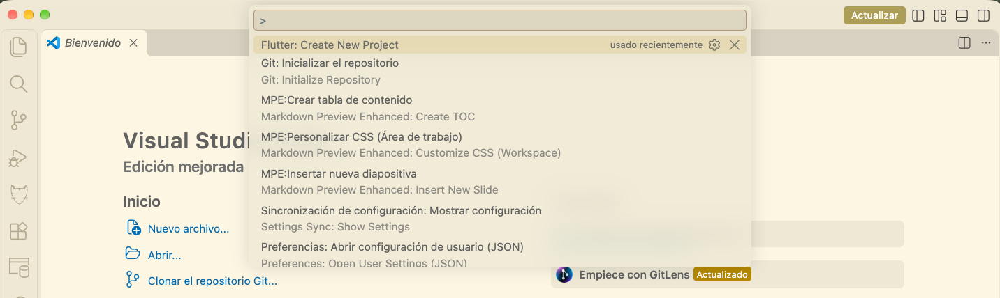
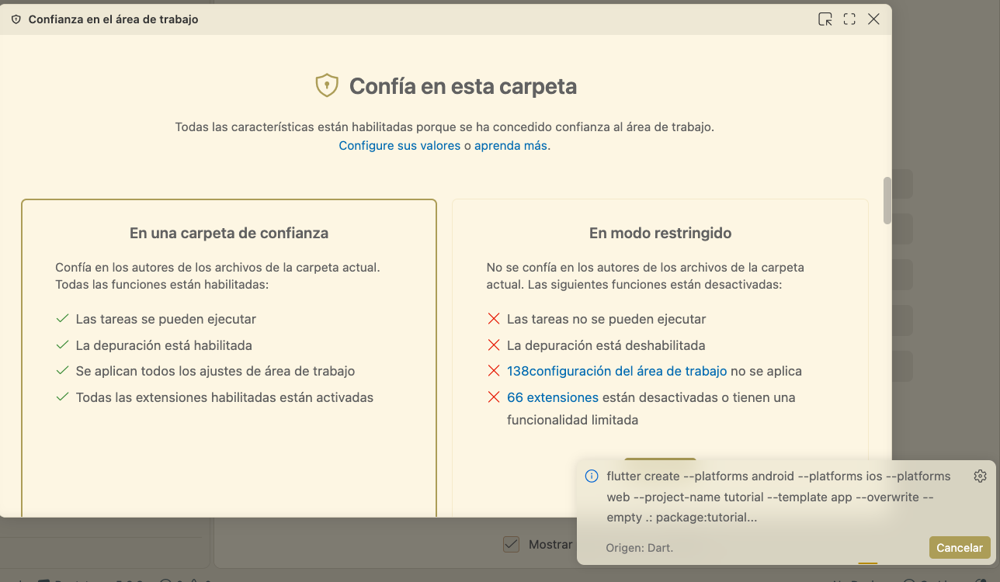
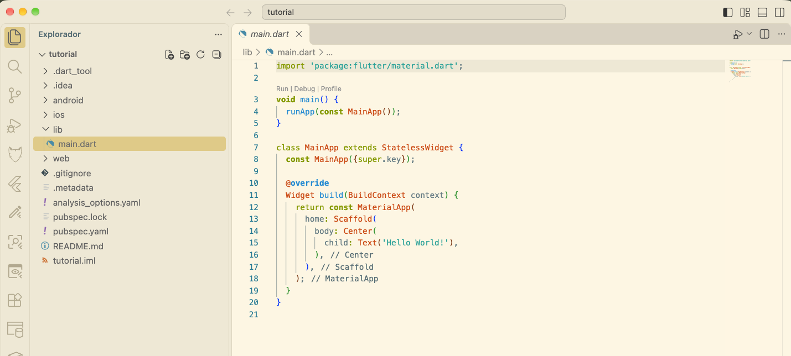
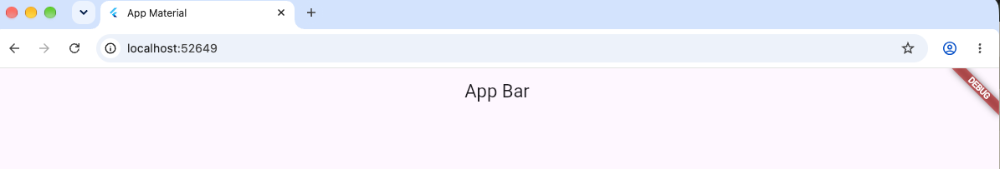
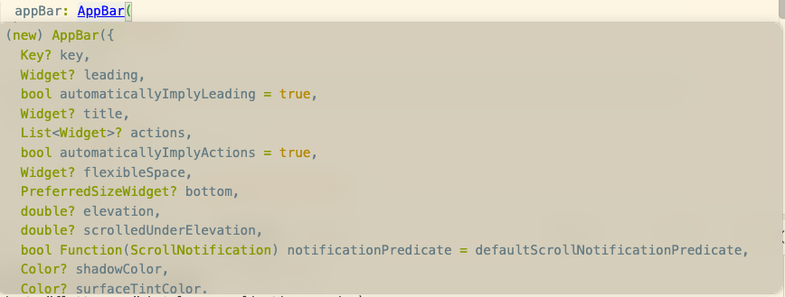

# Flutter Resumido

En esta guía, repasaré de forma muy concisa las cosas más básicas de Flutter. En los apuntes, se trabaja el SDK de forma exhaustiva y muy completa, pero, precisamente por eso, también muy densa. 

Es por ello que aquí vamos a hacer las cosas lo más rápido posible, siendo parcos en explicaciones (porque están en los apuntes principales) y yendo a lo más importante.

## 1 Introducción a los Widgets

### 1.1 Crea tu proyecto

Lo primero, después de haber instalado Flutter en tu sistema, es crear un proyecto. Para ello, podemos usar el menú interactivo de VS CODE.



Elegimos el tipo de aplicación, le ponemos un nombre en snake_case y luego elegimos las plataformas de destino. Si es para hacer pruebas rápidas, elige web, tu sistema operativo y el sistema operativo de tu móvil. Cuantas menos elijas, más ligero irá el proyecto.

Después, dale permisos a la carpeta para que se ejecute el script `flutter.create`.
 

En la carpeta lib es donde vamos a meter todo nuestro código, pero el resto de carpetas son necesarias para que funcione el proyecto.

Dentro de la carpeta lib podemos crear otras carpetas para tener el código más organizado.



Este es el código que viene por defecto:

```dart
import 'package:flutter/material.dart';

void main() {
  runApp(const MainApp());
}

class MainApp extends StatelessWidget {
  const MainApp({super.key});

  @override
  Widget build(BuildContext context) {
    return const MaterialApp(
      home: Scaffold(
        body: Center(
          child: Text('Hello World!'),
        ),
      ),
    );
  }
}
```

Lo comentamos por encima:

```dart
import 'package:flutter/material.dart';
```
Material es el paquete más importante, donde están todos los widgets que vamos a usar en Flutter.

```dart

void main() {
  runApp(const MainApp());
}
```
La función main es el punto de entrada de nuestra aplicación. Desde ella, se llama a propia aplicación. Al constar de una sola línea, se puede escribir usando `=>`.
```dart
void main() => runApp(const MainApp());
```

A continuación, está el código de nuestra aplicación por defecto. `MainApp` es un StatelessWidget, es decir, un widget que no guarda información del estado de la aplicación.

```dart
class MainApp extends StatelessWidget {
```
Lo primero es llamar al constructor, al que le pasamos el parámetro `key` de la clase base. `key` es un objeto que sirve para identificar un Widget de forma única dentro del árbol de widgets.

```dart
  const MainApp({super.key});
```
Lo siguiente es llamar a la función build del Widget. Las funciones build son una especie de constructores, pero que funcionan por pasos.

La función build recibe otra función (un 'callback'), que creamos en el momento.

```dart
  @override
  Widget build(BuildContext context) {
```
La función build devuelve un MaterialApp. Es decir, una pantalla.

En este caso concreto, la pantalla consta de un andamiaje (el Scaffold) donde se colocan el resto de elementos. Un contenedor que centra lo que haya dentro y un Widget que muestra un texto, `Hello World!`.

```dart
    return const MaterialApp(
      home: Scaffold(
        body: Center(
          child: Text('Hello World!'),
        ),
      ),
    );
  }
}
```

Para ejecutarlo, abre un terminal (que se abre por defecto en el root del proyecto) y escribe `flutter run`. Tendrás un bonito programa.

### 1.2 AppBar y Botones

A continuación, vamos a comentar el siguiente ejemplo, donde se ponen en uso la barra de aplicaciones (appBar) y un tipo de botón.

```dart
import 'package:flutter/material.dart';

void main() => runApp(const MyApp());

class MyApp extends StatelessWidget {
  const MyApp({super.key});
  @override
  Widget build(BuildContext context) {
    return MaterialApp(
      title: 'App Material',
      home: Scaffold(
        appBar: AppBar(
          title: const Text(
            'App Bar',
          ),
        ),
        body: const Center(
          child: Text('Hello World'),
        ),
        floatingActionButton: FloatingActionButton(
          onPressed: () {},
          child: const Icon(Icons.add),
        ),
      ),
    );
  }
}
```

Vamos a comentar lo que pasa en el return. Una de las cosas que nos permite el andamiaje, es decir, el Scaffold, es añadir una barra de aplicación. La barra de aplicación puede ser una clase que nosotros creemos, pero Flutter tiene una clase ya hecha `AppBar`, que probablemente nos sea más que suficiente. A esa clase le añadimos un título, y ella misma se encargará de ponerse en la parte superior

```dart
Widget build(BuildContext context) {
    return MaterialApp(
      title: 'App Material',
      home: Scaffold(
        appBar: AppBar(
          title: const Text(
            'App Bar',
          ),
        ),
```

Podemos cambiar muchas más cosas, como podemos observar si dejamos el ratón sobre AppBar:


Por ejemplo, podemos hacer los siguientes cambios:
```dart
appBar: AppBar(
          title: const Text(
            'App Bar',
          ),
          
          backgroundColor: Colors.amber,
          leading: const Text('Here it is the leading part')
```
Al pulsar `R` mientras se ejecuta (teniendo el foco en el terminal donde está ejecutándose Flutter), la aplicación hará un `hot reload` y podremos ver los cambios que hemos hecho.

Después tenemos el body, que sigue siendo un texto, y un FloatingActionButton, que es un botón que se sitúa por defecto abajo a la derecha. El botón tiene una acción (que no hace nada) y un icono.
```dart
        body: const Center(
          child: Text('Hello World'),
        ),
        floatingActionButton: FloatingActionButton(
          onPressed: () {},
          child: const Icon(Icons.add),
        ),
      ),
    );
  }
```

Podemos cambiar la acción por: `onPressed: ()=>print('action pushed')` y nos mostrará el texto en terminal. Esto no hay que hacerlo en aplicaciones en producción, pero nos puede ayudar a hacer pruebas.

### 1.3 Stateful Widgets

Los Stateful Widgets son aquellos que pueden almacenar información y se imprimen a sí mismos. Dicho de otro modo, aquellos que pueden cambiar lo que muestran.

Para ello, tenemos que diferenciar el Widget del estado. Lo que se renderizará cada vez es el estado, y es ahí donde pondremos toda la lógica del Widget. 

Podemos añadirle atributos y cambiarlos durante la ejecución, aunque deberemos usar la función intermediaria `setState()`.

Veamos el código siguiente:

```dart

import 'package:flutter/material.dart';

void main() => runApp(const MyApp());

class MyApp extends StatelessWidget {
  const MyApp({super.key});
  @override
  Widget build(BuildContext context) {
    return MaterialApp(
      title: 'App Material',
      home: Scaffold(
        appBar: AppBar(
          title: const Text(
            'App Bar',
          ),
          
          backgroundColor: Colors.amber,
          leading: const Text('Here it is the leading part')
        ),
        body: Center(
          child: Counter(),
        ),
      ),
        
      
    );
  }
}

class Counter extends StatefulWidget {
  const Counter({super.key});

  @override
  State<Counter> createState() => _CounterState();
}

class _CounterState extends State<Counter> {
  int counter = 0;
  @override
  Widget build(BuildContext context) {
    return Column(
      children: [
        Text("Contador = $counter"),
        ElevatedButton(onPressed: ()=>setState(() {
          counter += 1;
        }), child: Icon(Icons.add),)
      ],

    );
  }
}
```

Ahora vamos a desglosar las partes diferentes. Lo que vamos a hacer es sustituir el Text de antes por una clase que hemos creado, el Counter. Aunque sea Stateful, a la hora de añadirla el proceso no cambia.

Como vemos, para el Stateful Widget necesitamos el Widget en sí, que tiene el constructor y una función para crear el estado. Por convenio, el estado empieza con el caracter `_` y termina con la palabra `State`, siendo lo intermedio el nombre del Widget.

```dart
class Counter extends StatefulWidget {
  const Counter({super.key});

  @override
  State<Counter> createState() => _CounterState();
}
```
Es en el estado donde vamos a hacer el proceso de construir el Widget tal y como se ve. Le añadimos un atributo para almacenar información, en este caso un entero.

Cuando lo construyamos, crearemos una columna Column. El Column en lugar de tener la propiedad child, tiene la propiedad children, que recibe una lista de Widgets, entre corchetes []. 

Los widgets que añadimos es un texto, donde escribiremos el valor de la variable counter. Como va cambiando, el widget no puede ser const.

El segundo widget es un elevated button, que nos obliga a usar un callback en el atributo onPressed:, donde pondremos una función anónima que llame al método `setState` para que actualice el valor del atributo counter. En el apartado child ponemos un widget de tipo Icon, y seleccionamos el icono que queremos de los iconos almacenados en el pseudo enumerador Icons (es en realidad una clase abstracta que almacena información, pero a nivel de cómo lo usamos se parece a un enumerador). Elegimos el icono Icons.add.

```dart
class _CounterState extends State<Counter> {
  int counter = 0;
  @override
  Widget build(BuildContext context) {
    return Column(
      children: [
        Text("Contador = $counter"),
        ElevatedButton(onPressed: ()=>setState(() {
          counter += 1;
        }), child: Icon(Icons.add),)
      ],

    );
  }
}
``` 

## El Future Builder


