# Flutter Resumido

En esta guía, repasaré de forma muy concisa las cosas más básicas de Flutter. En los apuntes, se trabaja el SDK de forma exhaustiva y muy completa, pero, precisamente por eso, también muy densa. 

Es por ello que aquí vamos a hacer las cosas lo más rápido posible, siendo parcos en explicaciones (porque están en los apuntes principales) y yendo a lo más importante.

## 1 Introducción a los Widgets

### 1.1 Crea tu proyecto

Lo primero, después de haber instalado Flutter en tu sistema, es crear un proyecto. Para ello, podemos usar el menú interactivo de VS CODE.

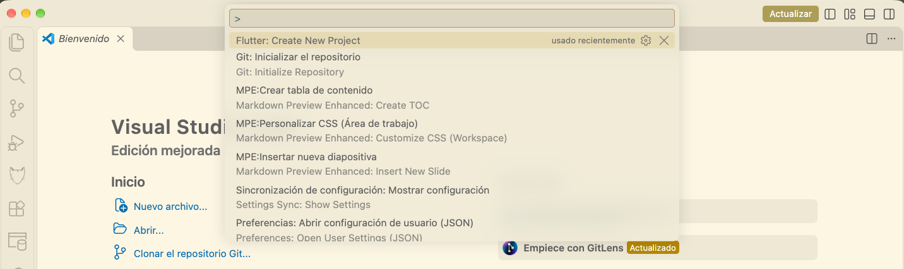

Elegimos el tipo de aplicación, le ponemos un nombre en snake_case y luego elegimos las plataformas de destino. Si es para hacer pruebas rápidas, elige web, tu sistema operativo y el sistema operativo de tu móvil. Cuantas menos elijas, más ligero irá el proyecto.

Después, dale permisos a la carpeta para que se ejecute el script `flutter.create`.
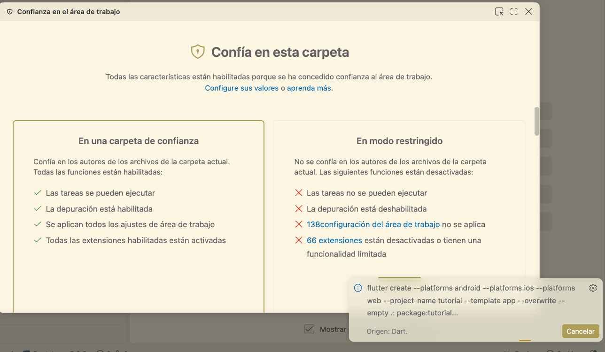 

En la carpeta lib es donde vamos a meter todo nuestro código, pero el resto de carpetas son necesarias para que funcione el proyecto.

Dentro de la carpeta lib podemos crear otras carpetas para tener el código más organizado.

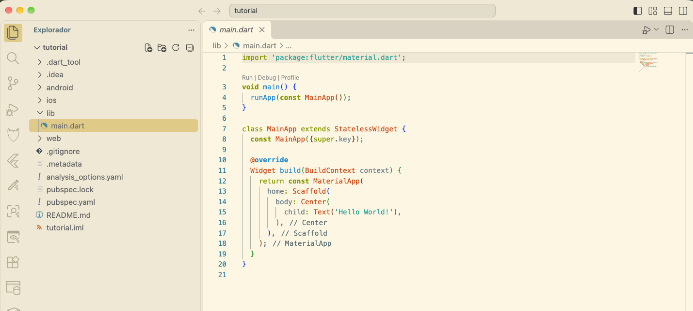

Este es el código que viene por defecto:

```dart
import 'package:flutter/material.dart';

void main() {
  runApp(const MainApp());
}

class MainApp extends StatelessWidget {
  const MainApp({super.key});

  @override
  Widget build(BuildContext context) {
    return const MaterialApp(
      home: Scaffold(
        body: Center(
          child: Text('Hello World!'),
        ),
      ),
    );
  }
}
```

Lo comentamos por encima:

```dart
import 'package:flutter/material.dart';
```
Material es el paquete más importante, donde están todos los widgets que vamos a usar en Flutter.

```dart

void main() {
  runApp(const MainApp());
}
```
La función main es el punto de entrada de nuestra aplicación. Desde ella, se llama a propia aplicación. Al constar de una sola línea, se puede escribir usando `=>`.
```dart
void main() => runApp(const MainApp());
```

A continuación, está el código de nuestra aplicación por defecto. `MainApp` es un StatelessWidget, es decir, un widget que no guarda información del estado de la aplicación.

```dart
class MainApp extends StatelessWidget {
```
Lo primero es llamar al constructor, al que le pasamos el parámetro `key` de la clase base. `key` es un objeto que sirve para identificar un Widget de forma única dentro del árbol de widgets.

```dart
  const MainApp({super.key});
```
Lo siguiente es llamar a la función build del Widget. Las funciones build son una especie de constructores, pero que funcionan por pasos.

La función build recibe otra función (un 'callback'), que creamos en el momento.

```dart
  @override
  Widget build(BuildContext context) {
```
La función build devuelve un MaterialApp. Es decir, una pantalla.

En este caso concreto, la pantalla consta de un andamiaje (el Scaffold) donde se colocan el resto de elementos. Un contenedor que centra lo que haya dentro y un Widget que muestra un texto, `Hello World!`.

```dart
    return const MaterialApp(
      home: Scaffold(
        body: Center(
          child: Text('Hello World!'),
        ),
      ),
    );
  }
}
```

Para ejecutarlo, abre un terminal (que se abre por defecto en el root del proyecto) y escribe `flutter run`. Tendrás un bonito programa.

> **ACTIVIDAD:** Prueba a crear tu propio programa. Prueba a meter en el body del Scaffold directamente el texto. Prueba otros widgets de posicionamiento como [Align](https://api.flutter.dev/flutter/widgets/Align-class.html) (que requiere usar `alignment: Alignment(double x, double y)` como parámetro con nombre, aparte de `child`)

### 1.2 AppBar y Botones

A continuación, vamos a comentar el siguiente ejemplo, donde se ponen en uso la barra de aplicaciones (appBar) y un tipo de botón.

```dart
import 'package:flutter/material.dart';

void main() => runApp(const MyApp());

class MyApp extends StatelessWidget {
  const MyApp({super.key});
  @override
  Widget build(BuildContext context) {
    return MaterialApp(
      title: 'App Material',
      home: Scaffold(
        appBar: AppBar(
          title: const Text(
            'App Bar',
          ),
        ),
        body: const Center(
          child: Text('Hello World'),
        ),
        floatingActionButton: FloatingActionButton(
          onPressed: () {},
          child: const Icon(Icons.add),
        ),
      ),
    );
  }
}
```

Vamos a comentar lo que pasa en el return. Una de las cosas que nos permite el andamiaje, es decir, el Scaffold, es añadir una barra de aplicación. La barra de aplicación puede ser una clase que nosotros creemos, pero Flutter tiene una clase ya hecha `AppBar`, que probablemente nos sea más que suficiente. A esa clase le añadimos un título, y ella misma se encargará de ponerse en la parte superior

```dart
Widget build(BuildContext context) {
    return MaterialApp(
      title: 'App Material',
      home: Scaffold(
        appBar: AppBar(
          title: const Text(
            'App Bar',
          ),
        ),
```

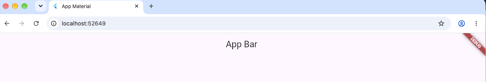

Podemos cambiar muchas más cosas, como podemos observar si dejamos el ratón sobre AppBar:
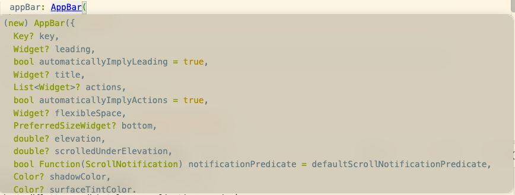

Por ejemplo, podemos hacer los siguientes cambios:
```dart
appBar: AppBar(
          title: const Text(
            'App Bar',
          ),
          
          backgroundColor: Colors.amber,
          leading: const Text('Here it is the leading part')
```
Al pulsar `R` mientras se ejecuta (teniendo el foco en el terminal donde está ejecutándose Flutter), la aplicación hará un `hot reload` y podremos ver los cambios que hemos hecho.

Después tenemos el body, que sigue siendo un texto, y un FloatingActionButton, que es un botón que se sitúa por defecto abajo a la derecha. El botón tiene una acción (que no hace nada) y un icono.
```dart
        body: const Center(
          child: Text('Hello World'),
        ),
        floatingActionButton: FloatingActionButton(
          onPressed: () {},
          child: const Icon(Icons.add),
        ),
      ),
    );
  }
```

Podemos cambiar la acción por: `onPressed: ()=>print('action pushed')` y nos mostrará el texto en terminal. Esto no hay que hacerlo en aplicaciones en producción, pero nos puede ayudar a hacer pruebas.

> **ACTIVIDAD:** Crea una Appbar con los diferentes elementos rellenados y mira a ver qué pasa.

### 1.3 Stateful Widgets

Los Stateful Widgets son aquellos que pueden almacenar información y se imprimen a sí mismos. Dicho de otro modo, aquellos que pueden cambiar lo que muestran.

Para ello, tenemos que diferenciar el Widget del estado. Lo que se renderizará cada vez es el estado, y es ahí donde pondremos toda la lógica del Widget. 

Podemos añadirle atributos y cambiarlos durante la ejecución, aunque deberemos usar la función intermediaria `setState()`.

Veamos el código siguiente:

```dart

import 'package:flutter/material.dart';

void main() => runApp(const MyApp());

class MyApp extends StatelessWidget {
  const MyApp({super.key});
  @override
  Widget build(BuildContext context) {
    return MaterialApp(
      title: 'App Material',
      home: Scaffold(
        appBar: AppBar(
          title: const Text(
            'App Bar',
          ),
          
          backgroundColor: Colors.amber,
          leading: const Text('Here it is the leading part')
        ),
        body: Center(
          child: Counter(),
        ),
      ),
        
      
    );
  }
}

class Counter extends StatefulWidget {
  const Counter({super.key});

  @override
  State<Counter> createState() => _CounterState();
}

class _CounterState extends State<Counter> {
  int counter = 0;
  @override
  Widget build(BuildContext context) {
    return Column(
      children: [
        Text("Contador = $counter"),
        ElevatedButton(onPressed: ()=>setState(() {
          counter += 1;
        }), child: Icon(Icons.add),)
      ],

    );
  }
}
```

Ahora vamos a desglosar las partes diferentes. Lo que vamos a hacer es sustituir el Text de antes por una clase que hemos creado, el Counter. Aunque sea Stateful, a la hora de añadirla el proceso no cambia.

Como vemos, para el Stateful Widget necesitamos el Widget en sí, que tiene el constructor y una función para crear el estado. Por convenio, el estado empieza con el caracter `_` y termina con la palabra `State`, siendo lo intermedio el nombre del Widget.

```dart
class Counter extends StatefulWidget {
  const Counter({super.key});

  @override
  State<Counter> createState() => _CounterState();
}
```
Es en el estado donde vamos a hacer el proceso de construir el Widget tal y como se ve. Le añadimos un atributo para almacenar información, en este caso un entero.

Cuando lo construyamos, crearemos una columna `Column`. El Column en lugar de tener la propiedad child, tiene la propiedad children, que recibe una lista de Widgets, entre corchetes []. 

Los widgets que añadimos es un texto, donde escribiremos el valor de la variable counter. Como va cambiando, el widget no puede ser const.

El segundo widget es un elevated button, que nos obliga a usar un callback en el atributo onPressed:, donde pondremos una función anónima que llame al método `setState` para que actualice el valor del atributo counter. En el apartado child ponemos un widget de tipo Icon, y seleccionamos el icono que queremos de los iconos almacenados en el pseudo enumerador Icons (es en realidad una clase abstracta que almacena información, pero a nivel de cómo lo usamos se parece a un enumerador). Elegimos el icono Icons.add.

```dart
class _CounterState extends State<Counter> {
  int counter = 0;
  @override
  Widget build(BuildContext context) {
    return Column(
      children: [
        Text("Contador = $counter"),
        ElevatedButton(onPressed: ()=>setState(() {
          counter += 1;
        }), child: Icon(Icons.add),)
      ],

    );
  }
}
```

> **ACTIVIDAD:** Convierte la pantalla principal en StatefulWidget. Haz que cambie de color el fondo cuando cliques a un botón.

## 2. El Future Builder

El Future Builder sirve para poder usar Future dentro de los widgets. Esto es para evitar que la interfaz se bloquee, por ejemplo, al consultar una base de datos o realizar cualquier operación que no sea instantánea.

```dart
FutureBuilder(
  future: Future,
  initialData: InitialData,
  builder: (BuildContext context, AsyncSnapshot snapshot){
    return;
  },
),
```

En future ponemos la función que se ejecutará y ese valor pasará al builder a través de AsyncSnapshot. En este ejemplo se puede observar:

```dart
Future<String> asyncFunction(){
  return Future.delayed(const Duration(seconds: 5),(){
    return 'valor de retorno';
  });
}
class MyWidgetAsync extends StatelessWidget{
  const MyWidgetAsync({super.key});

  @override
  Widget build(BuildContext context) {
    return FutureBuilder(
      future: asyncFunction(),
      initialData: "EN ESPERA",
      builder: (BuildContext context, AsyncSnapshot snapshot) {
        String text = "";
        if (snapshot.hasData) text = snapshot.data.toString();
        return Text(text);
      },
    );
  }
}
```

La función asíncrona, para simular un retraso, emplea Future.delayed durante 3 segundos. Entonces, cuando pasen esos 3 segundos se construirá el widget, con la información obtenida en dicha función. Mientras tanto, mostrará el valor de `initialData`. Para probarlo, podemos meter el widget en cualquier ventana, por ejemplo la del contador:
```dart
class Counter extends StatefulWidget {
  const Counter({super.key});

  @override
  State<Counter> createState() => _CounterState();
}

class _CounterState extends State<Counter> {
  int counter = 0;
  @override
  Widget build(BuildContext context) {
    return Column(
      children: [
        Text("Contador = $counter"),
        ElevatedButton(onPressed: ()=>setState(() {
          counter += 1;
        }), child: Icon(Icons.add),),
        MyWidgetAsync() ///<- LO METEMOS AQUÍ, COMO UN HIJO MÁS DE COLUMN>
      ],

    );
  }
}
```

En resumidas cuentas, lo que hace es retrasar la construcción del widget hasta que la función con el Future se resuelva. Es práctico para componentes dentro de una ventana, pero no para ventanas en sí mismas.

> **ACTIVIDAD:** Crea otro FutureBuilder. Haz que consulte la API  healthy (https://healthys-express-backend-production.up.railway.app/) y muestre los resultados en un Text. De forma opcional, puedes darle un formato bonito. Muestra lo que hay en un endpoint, por ejemplo /api/entrants. Consulta el apartado `http` del tema anterior.

## 3. Navigator

### 3.1 Navegación básica con `Navigator`, `MaterialPageRoute`, `push`, `pop`, `canPop` y `maybePop`

Navigator es un widget que sirve para navegar por diferentes ventanas de nuestra aplicación. Utiliza los métodos push y pop para apilar ventanas y desapilarlas. Las ventanas son widgets que hemos creado.

Navigator.push recibe como parámetros context, para saber el contexto de la aplicación, y un MaterialPageRoute, que es como MaterialApp, pero nos permite usar la navegación. 

Navigator.pop solo recibe el contexto de la aplicación. Sólo se puede hacer pop si se ha hecho previamente push. Podemos comprobarlo mediante la función canPop o, si queremos hacerlo todo a la vez, mediante la función maybePop (que combina canPop y pop).

Continuando con el ejemplo anterior, en la columna del contador vamos a añadir un botón para navegar a una nueva pantalla, que llamaremos Pantalla2:

```dart
class _CounterState extends State<Counter> {
  int counter = 0;
  @override
  Widget build(BuildContext context) {
    return Column(
      children: [
        Text("Contador = $counter"),
        ElevatedButton(
          onPressed: () => setState(() {
            counter += 1;
          }),
          child: Icon(Icons.add),
        ),
        MyWidgetAsync(),
        ElevatedButton( //AÑADIMOS UN ELEVATED BUTTON PARA LA NAVEGACIÓN
          child: const Text('ir a otra pantalla'),
          onPressed: () {
            Navigator.push(
              context,
              MaterialPageRoute(builder: (context) => Pantalla2()), 
            );
          },
        ),
      ],
    );
  }
}
```

De esta forma, al pulsar en el botón "ir a otra pantalla", viajaremos a la pantalla que hayamos definido en pantalla2, por ejemplo, esta:

```dart
class Pantalla2 extends StatelessWidget {
  const Pantalla2({super.key});

  @override
  Widget build(BuildContext context) {
    return MaterialApp(
      home: Column(
        children: [
          MyWidgetAsync(),
          ElevatedButton(
            onPressed: () {
              Navigator.maybePop(context);
            },
            child: const Text("volver"),
          ),
        ],
      ),
    );
  }
}
```
Usamos el maybePop para ahorrarnos la comprobación del canPop. 

> **CURIOSIDAD:** Cuando viajamos a la segunda ventana, el texto aparece con una fuente extraña. Esta fuente se conoce como `_errorTextStyle` y `MaterialApp` lo coloca intencionalmente para advertirnos de que el texto se está mostrando sin emplear los widgets de texto adecuados, generalmente `Scaffold`. Podemos solventarlo modificando el parámetro `style` y eligiendo el que queramos pero, ¿es sabio no escuchar las advertencias de los creadores?

> **ACTIVIDAD:** ¿Recuerdas la consulta al endpoint en la actividad anterior? Pásalo a una pantalla nueva. Haz una pantalla por cada uno de los endpoints y navega de una a otra usando botones y la instrucción push. Implementa en todas las pantallas la instrucción pop para volver a la pantalla anterior. 

## 3.2 Pasar argumentos entre pantallas

Si queremos pasar argumentos entre pantallas, tenemos que diseñar las pantallas de tal forma que, en el constructor, reciban el argumento que queremos. Por ejemplo, vamos a modificar `pantalla2` para que reciba un valor entero, que será el del contador.

```dart
class Pantalla2 extends StatelessWidget {
  final int? counterValue;
  const Pantalla2({this.counterValue, super.key});

  @override
  Widget build(BuildContext context) {
    return MaterialApp(
      home: Column(
        children: [
          Text("El valor del contador es $counterValue"),
          MyWidgetAsync(),
          ElevatedButton(
            onPressed: () {
              Navigator.maybePop(context);
            },
            child: const Text("volver"),
          ),
        ],
      ),
    );
  }
}
```
Además de ver cómo añadimos el valor del contador como parámetro opcional con nombre, podemos observar que, mientras que el texto del botón `volver` está precedido por `const`, el texto que tiene la variable dentro no puede ser `const`. Además, al ser un valor opcional, si no añadimos nada cuando se construlla `Pantalla2`, seguirá funcionando igual. Por eso, hacemos esta modificación:

```dart
class _CounterState extends State<Counter> {
  int counter = 0;
  @override
  Widget build(BuildContext context) {
    return Column(
      children: [
        Text("Contador = $counter"),
        ElevatedButton(
          onPressed: () => setState(() {
            counter += 1;
          }),
          child: Icon(Icons.add),
        ),
        MyWidgetAsync(),
        ElevatedButton(
          child: const Text('ir a otra pantalla'),
          onPressed: () {
            Navigator.push(
              context,
              MaterialPageRoute(builder: (context) => Pantalla2(counterValue: counter,)),
            );
          },
        ),
      ],
    );
  }
}
```
Así, veremos el valor de retorno. Después, al presionar volver, volveremos a la página anterior y el valor continuará presente. Esto sucede porque lo que hacemos es desapilar la página. Es decir, la primera pantalla nunca cambia. Si hiciéramos un push para volver, el valor no se mantendría porque al hacer push lo que hacemos es crear una nueva pantalla con un `key` distinto.

> **ACTIVIDAD:** Recogiendo la actividad anterior, en lugar de tener una pantalla por cada endpoint del api, haz una sola pantalla que reciba como argumento el URI (`/api/entrants`, por ejemplo, es un URI). 
>
>Tendrás una sola pantalla, pero en la pantalla inicial tendrás tantos botones como endpoints, y todos ellos te llevarán a la pantalla, pero con un argumento distinto. 
>
>Impleméntalo para que funcione igual que el de la actividad anterior.

## 3.3 Refactorizar. Separar las clases en archivos y organizarlas en carpetas. Arreglar imports.

Aunque este apartado no pertenece a la navegación en sí, al ir creando nuevas pantallas en el archivo `main.dart` podemos observar como se nos queda un código desordenado y feo. La solución pasa por mover las diferentes pantallas a archivos separados y, es más, que esos archivos estén dentro de una carpeta `screens`. Yendo más lejos, se podrían meter esta carpeta en otra llamada `ui` (user interface), si aparte de las pantallas necesitamos otros elementos en la interfaz de usuario. 

Así pues, dentro de la carpeta `lib`, vamos a crear una carpeta `screens`. Una vez hecho esto, seleccionamos los diferentes elementos, hacemos click derecho y pulsamos refactorizar.

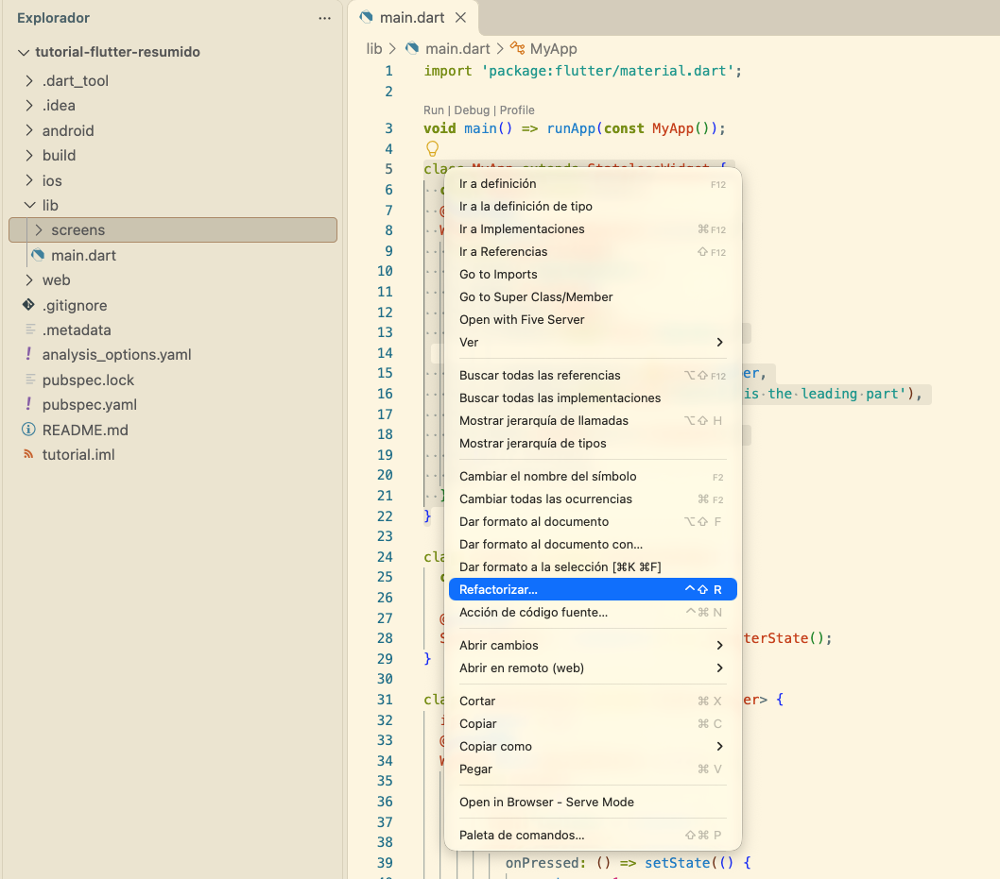

Eso nos permite convertirlo en un StatefulWidget sin hacer nada, si es Stateless, y después, seleccionando el resultado, moverlas a un archivo aparte. Al moverlas así, la importación se pondrá de forma automática.  

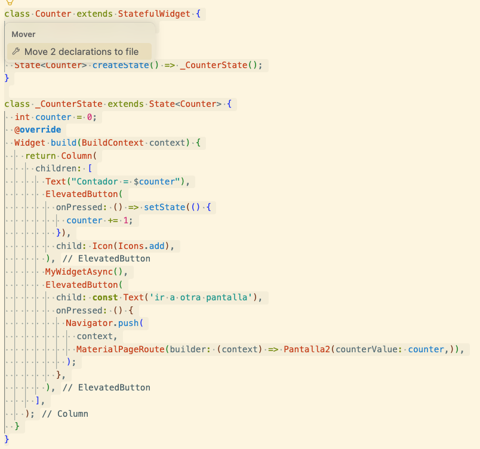
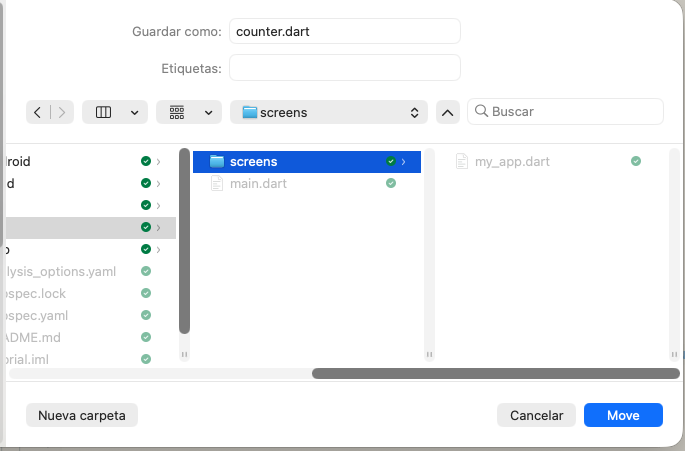

Ahora bien, podemos hacerlo también de forma manual. Vamos a mover `Pantalla2` a su propio archivo. El nombre del archivo tiene que estar en snake_case, es decir, minúsculas y guiones bajos separando palabras. Así, el nuestro se llamará `pantalla_2.dart`.
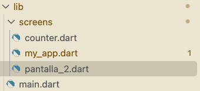

Una vez creado, copiamos el código de la pantalla_2 dentro y lo quitamos del archivo `main.dart`. Usa la instrucción `cortar`. Ahora necesitamos arreglar los imports. Lo primero es añadir el import de material.

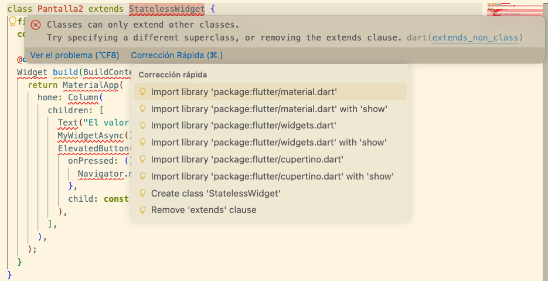

Ahora veremos que no tiene acceso a `MyWidgetAsync()`. Esta función es parte de las pantallas, pero no es una pantalla. Podemos crear su propio paquete `utils` dentro de screens y copiarlo ahí. Requerirá importar `material.dart` también.

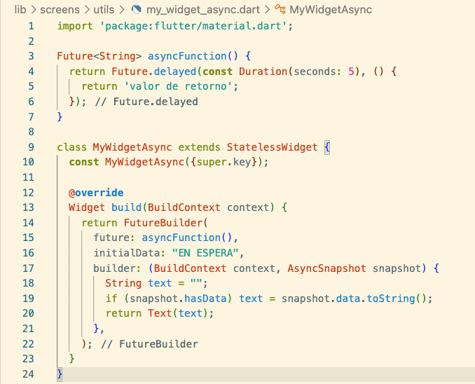

Ahora sí, podemos ir a aquellos archivos que usaran `MyWidgetAsync` e importar el archivo  `my_widget_async.dart`. Corregimos las importaciones, borrando las que no necesitemos y añadiendo las que falten, y tendremos el proyecto libre de errores y ordenador. Ejecutamos `flutter run` de nuevo para comprobar que todo funciona.

> **ACTIVIDAD:** Refactoriza tus actividades anteriores para que sigan funcionando bien. Guarda una captura de la organización de los ficheros.

### 3.4 Trabajar con formularios y `TextField`

Un `TextField` es un tipo de entrada muy usada en formularios. En ella, puedes escribir texto y dicha información puede viajar, como hemos visto en el punto anterior, por toda la aplicación. Sin embargo, para funcionar, un `TextField` necesita un tipo de variable especial, un controlador (en este caso `TextEditingControler`) donde se almacene la información.

Podemos reutilizar nuestro counter y nuestra pantalla 2. Vamos a cambiar `Pantalla2` para que admita un parámetro más. Aparte, cuando se muestre el texto añadirá el nombre que le pasemos o `nadie`, si no le pasamos nada:

```dart
class Pantalla2 extends StatelessWidget {
  final int? counterValue;
  final String? name;
  const Pantalla2({this.counterValue, this.name, super.key});

  @override
  Widget build(BuildContext context) {
    return MaterialApp(
      home: Column(
        children: [
          Text("El valor del contador es $counterValue y quien lo ha pulsado es ${name ?? 'nadie'}"),
          MyWidgetAsync(),
          ElevatedButton(
            onPressed: () {
              Navigator.maybePop(context);
            },
            child: const Text("volver"),
          ),
        ],
      ),
    );
  }
}
```
Una vez hecho esto, en el contador podemos añadir el TextField con su controlador (y una etiqueta en forma de texto para indicar al usuario lo que debe poner en el TextField). Para enviar el texto del controlador a la pantalla 2, tenemos que enviarle su propiedad text. En este caso, verás `_controller.text`.

```dart
class Counter extends StatefulWidget {
  const Counter({super.key});

  @override
  State<Counter> createState() => _CounterState();
}

class _CounterState extends State<Counter> {
  int counter = 0;
  final TextEditingController _controller = TextEditingController(); //<- AQUÍ CREAMOS EL CONTROLLER
  @override
  Widget build(BuildContext context) {
    return Column(
      children: [
        Text("Contador = $counter"),
        ElevatedButton(
          onPressed: () => setState(() {
            counter += 1;
          }),
          child: Icon(Icons.add),
        ),
        MyWidgetAsync(),
        const Text("Pon tu nombre:"),
        TextField(controller: _controller), // <-AQUÍ CREAMOS EL TEXFIELD Y LE ASIGNAMOS EL CONTROLLER>
        ElevatedButton(
          child: const Text('ir a otra pantalla'),
          onPressed: () {
            Navigator.push(
              context,
              MaterialPageRoute(
                builder: (context) =>
                    Pantalla2(counterValue: counter, name: _controller.text), //AQUÍ LE MANDAMOS EL TEXTO DEL CONTROLLER A LA PANTALLA 2
              ),
            );
          },
        ),
      ],
    );
  }
}
```
Lo único que trabajar así con un TextField es rudimentario por una cuestión estética. Debes encontrar tu toque personal empleando los diferentes tipos de contenedores disponibles en Flutter. Sin embargo, aunque inevitablemente tenemos que usar alguno (como Center, Column, etc), ese campo pertenece más al diseño de interfaces que a la programación multimedia en sí misma.

### 3.5 Trabajar con valores de retorno

También podemos enviar valores con la instrucción `pop` de vuelta a la pantalla anterior. Sin embargo, esto hace que tengamos que cambiar un poco la manera de trabajar. Ya que al refactorizar convertimos la pantalla My_app en un widget con estado, vamos a aprovechar eso para que podamos cambiar en una tercera pantalla el texto que sale donde poníamos `Here is the leading part`. Ese texto pasará dejar de ser const.

Hacer que esto funcione bien es un proceso complejo. Lo primero, y más fácil, es crear la pantalla a la que vamos a ir:

```dart
class Pantalla3 extends StatefulWidget{
  const Pantalla3({super.key});

  @override
  State<StatefulWidget> createState() => _Pantalla3State();

}
class _Pantalla3State extends State<Pantalla3>{
  final TextEditingController _controller = TextEditingController();
  @override
  Widget build(BuildContext context) {
    return 
      Scaffold(
        body: Column(
          children: [
            Text("Introduce un texto"),
            TextField(controller: _controller,),
            ElevatedButton(onPressed: ()=>Navigator.pop(context, _controller.text), child: const Text("Volver"))

          ],
        ),
      );
  } 
}
```
En el método `pop` añadimos el valor que obtenemos del `TextField`.

Ahora empieza lo complejo. En mi app, en su estado creamos una función asíncrona que nos permita la navegación y que, una vez concluida (por eso tiene que ser asíncrona), cambie el estado y edite el valor de la cabecera. Para ello, añadimos una variable `cabecera` y la función mencionada:

```dart
class _MyAppState extends State<MyApp> {
  String? cabecera;

  Future<void> _irPantalla3(BuildContext context) async {
    final String? respuesta = await Navigator.push(
      context,
      MaterialPageRoute(builder: (context) => Pantalla3()),
    );
    setState(() => cabecera = respuesta);
  }
```
La función, al final, realiza un `setState()` que es lo que va a hacer que el Widget se vuelva a pintar y veamos el texto de cabecera obtenido en `Pantalla3`. 

Ahora bien, tenemos un problema con el contexto (`BuildContext`). El contexto que recibimos en el método `build()` de `_MyAppState` pertenece a MyApp, que está por encima de `MaterialApp`. Por tanto, no puede encontrar el `Navigator` que crea `MaterialApp`.

Para solucionarlo podemos utilizar un widget llamado Builder. Este widget crea un nuevo contexto dentro del árbol de widgets, concretamente por debajo de `MaterialApp`. Así, cuando llamamos a `Navigator.push()`, utilizamos un contexto que sí puede encontrar el `Navigator`.

Simplemente, envolvemos el `Scaffold` en un `Builder` y ponemos el `Scaffold` como valor de retorno de la función anónima que requiere su propiedad `builder`.

```dart
 @override
  Widget build(BuildContext context) {
    return MaterialApp(
      title: 'App Material',
      home: Builder(
        builder: (context) {
          return Scaffold(
            appBar: AppBar(
              title: const Text('App Bar'),

              backgroundColor: Colors.amber,
              leading: Text(cabecera ?? 'it is the leading part'),
            ),
            body: Column(
              children: [
                ElevatedButton(
                  onPressed: () => _irPantalla3(context),
                  child: const Text("introduce texto de cabecera"),
                ),
                Center(child: Counter()),
              ],
            ),
          );
        },
      ),
    );
  }
}
```
Observa que, simplemente, se ha copiado el código que había (añadiendo el botón que invoca la pantalla 3) dentro de `Builder(builder: (context) { return;})`, para que gestionara los contextos y se pudiera lanzar la pantalla. **Esto lo hemos tenido que hacer porque se trata de la pantalla principal, la que tiene el `MaterialApp`.**

> **ACTIVIDAD:** Crea una pantalla que nos sirva para cambiar el color de la aplicación principal. Haz que tenga varios botones (al menos 2), cada uno con un color, y que al clicar en uno de ellos vuelva a la pantalla principal con dicho color.

> **CURIOSIDAD:** Otra cosa que podemos hacer es mover los atributos del estado al widget y acceder a ellos a través de la propiedad `widget`.

## 4. Widgets de navegación y diálogos emergentes

La navegación que hemos visto hasta ahora es una navegación directa, pero existen varias formas de organizarla y unificarla, a través de Widgets especializados. Además, también se puede realizar la navegación hacia ventanas modales, o diálogos.

### 4.1 NavigationBar

`NavigationBar` es un widget para navegar por distintas ventanas que se suele colocar en la propiedad `bottomNavigationBar` de `Scaffold`. Sirve para que naveguemos por diferentes páginas manteniendo el mismo `Scaffold` en todas. Para poder probarlo, crearemos un proyecto nuevo con tres ventanas. En cada una de ellas, simplemente se verá un texto con el número de la página.

```dart
class Screen3 extends StatelessWidget{
  const Screen3({super.key});

  @override
  Widget build(BuildContext context) {
    
    return Text("3");
  }
}
```

Ahora bien, para hacer nuestra `NavigationBar` necesitamos que el Widget que contiene el `Scaffold` sea `StatefulWidget`. Puede ser el principal, con el `MaterialApp`, o uno específico. Para que funcione todo bien, necesitamos una propiedad en el estado que sea el índice seleccionado.

```dart
class MainApp extends StatefulWidget {
  const MainApp({super.key});

  @override
  State<MainApp> createState() => _MainAppState();
}

class _MainAppState extends State<MainApp> {
  int currentIndex = 0;
```
Al crear el `Scaffold`, lo primero que vamos a hacer es un appBar que cambie en función del índice seleccionado, usando para ello una lista y un índice que indique en qué sitio de la lista estamos.

```dart
  @override
  Widget build(BuildContext context) {
    return MaterialApp(
      home: Scaffold(
        appBar: AppBar(
          title: [
            const Text("Screen 1"),
            const Text("Screen 2"),
            const Text("Screen 3"),
          ][currentIndex],
```
Es decir, **lo que hay dentro de `title` no es una matriz de dos dimensiones, sino la definición de una lista y, después, la selección de qué elemento de la lista se visualiza**. 

Lo siguiente es definir la propia barra de navegación. En la propiedad `bottomNavigationBar` colocamos la `NavigationBar`. Lo primero que definimos es qué sucede cuando pulsamos en uno de los destinos que definiremos luego. Para ello, usamos la función setState, que permite cambiar el valor del índice actual y que se redibuje el widget. Además, definimos cuál es el índice seleccionado (se corresponderá con la variable que alteramos en el estado).

```dart
bottomNavigationBar: NavigationBar(
          onDestinationSelected: (int index) {
            setState(() {
              currentIndex = index;
            });
          },
          selectedIndex: currentIndex,
```
Lo siguiente es definir los destinos. Igual que hemos hecho en la AppBar, vamos a crear una lista con las diferentes pantallas. Esto lo que hace es crear la barra de navegación, pero todavía no crea las diferentes pantallas.

```dart
destinations: const <Widget>[
            NavigationDestination(
              icon: Icon(Icons.people),
              selectedIcon: Icon(Icons.people_outline),
              label: "S1",
            ),
            NavigationDestination(
              icon: Icon(Icons.people),
              selectedIcon: Icon(Icons.people_outline),
              label: "S2",
            ),
            NavigationDestination(
              icon: Icon(Icons.people),
              selectedIcon: Icon(Icons.people_outline),
              label: "S3",
            ),
          ],
        ),
```
Usamos dos tipos de iconos, uno para cuando el destino no está seleccionado y otro para cuando esté seleccionado. Además, le ponemos una etiqueta para clarificar.

Para crear las pantallas, tenemos que utilizar, esta vez en el body del Scaffold, la misma técnica de crear una lista de widgets e indicar cuál es el que estará visible que usamos para la AppBar.

```dart
body: <Widget>[
          Center(child: Screen1()),
          Center(child: Screen2()),
          Center(child: Screen3())
        ][currentIndex]
      ),
    );
  }
}
```
Como se puede observar, no se trata de un proceso muy difícil, pero sí que es algo laborioso. Usando este tipo de navegación, la pantalla que cambiamos es, realmente, el body del Scaffold y no la pantalla entera. Muchas veces es, en realidad, lo que vamos a querer para nuestras aplicaciones.

NavigationRail funciona de forma análoga. Mantiene el AppBar exactamente igual, pero toda la información de navegación se coloca en el `body` del `Scaffold`. En lugar de NavigationBar, utiliza el widget NavigationRail y en lugar de NavigationDestination, emplea el widget NavigationRailDestination. Para poder poner el NavigationRail y el contenido en sí mismo, se emplean dos filas a través del widget `Row` y su propiedad `children`.

> **ACTIVIDAD:** Reproduce el ejemplo de las tres pantallas con NavigationBar y luego conviértelo a NavigationRail.

### 4.2 Diálogos (ventanas modales)

Un diálogo es una ventana modal que aparece en frente del contenido de la aplicación para proveer información crítica o solicitar una decisión.

Disponemos de los siguientes tipos de diálogos:
- `SnackBar`: Sirve para dar mensajes temporales.
- `MaterialBanner`: Sirve para dar información persistente.
- `Dialog`: Sirve para solicitar la acción o decisión del usuario.

La clase base de Flutter para trabajar con diálogos es `Dialog`, aunque generalmente se usan clases derivadas como `AlertDialog` o `SimpleDialog`.

La clase recibe como parámetros obligatorios `context` (el contexto de la aplicación) y `builder`(la ventana que vamos a mostrar), aunque tiene muchos otros parámetros opcionales que podemos consultar en la documentación.

Para poner un ejemplo, vamos a crear en `Screen1` un botón que lance una alerta. Lo que hace cada parte se explica en el código.
```dart
  @override
  Widget build(BuildContext context) {
    return Column(
      children: [
        const Text("Screen 1"),
        // A PARTIR DE AQUÍ CREAMOS EL BOTÓN
        ElevatedButton(
          onPressed: (){
            //SHOW DIALOG nos va a permitir mostrar el contenido, le pasamos context y el builder
            showDialog(
              context: context, 
              //EL builder es una función que devuelve el tipo de diálogo, en este caso AlertDialog
              builder: (context){
                return AlertDialog(
                  //Título, se pone en la parte superior de la ventana
                  title: const Text("Mi alerta"),
                  //Contenido, el texto que sale en la alerta
                  content: const Text("Contenido"),
                  //Las diferentes acciones de la alerta, en este caso crea un TextButton para salir 
                  actions: [
                    TextButton(
                      onPressed: ()=>Navigator.pop(context), 
                      child: const Text("Cancel")
                    )
                  ]
                );
              }
            );
          }, 
          child: const Text("Lancemos una alerta")),
      ],
    );
  }
```

Si quisiéramos capturar el contenido, deberíamos usar, como antes, un Future y también un StatefulWidget. Así pues, vamos a convertir la pantalla 2:

```dart
//Lo primero que hacemos es convertir en Stateful lo que teníamos, usando refactorizar
class Screen2 extends StatefulWidget {
  const Screen2({super.key});

  @override
  State<Screen2> createState() => _Screen2State();
}

class _Screen2State extends State<Screen2> {
  //Añadimos la variable que vamos a modificar
  String? valor;
  
  @override
  Widget build(BuildContext context) {
    
    return Column(
      children: [
        const Text("2"),
        //Este es el texto para mostrar el valor de la variable, o desconocido si es nulo
        Text("El valor es ${valor ?? 'desconocido'}"),
        //Creamos un elevated button que mostrará el diálogo como antes
        ElevatedButton(
          onPressed: () {
            //Como recibe un valor, tenemos que declararlo como futuro. Lo de más, es igual
            Future<String?> response = showDialog<String?>(
              context: context,
              builder: (context) {
                //Necesitamos el controlador, lo podemos crear aquí o antes.
                TextEditingController controller = TextEditingController();
                //Devolvemos la alerta, como antes, pero esta vez en el contenido hay un TextField
                return AlertDialog(
                  title: const Text("Introduce tu nombre"),
                  content: TextField(controller: controller),
                  actions: [
                    TextButton(
                      //Ahora el pop devuelve el contenido del texto del controller
                      onPressed: () => Navigator.pop(context, controller.text),
                      child: const Text("Salir"),
                    ),
                  ],
                );
              },
            );
            //Tenemos que definir lo que pasa cuando se completa el proceso. Ahí ponemos el setState
            response.then(
              (v) => setState(() {
                valor = v;
              }),
            );
          },
          child: const Text("Introducción de valores"),
        ),
      ],
    );
  }
}
```

Los apartados Simple Dialog, Dialog y Full-Screen Dialog son opcionales y están representados en los apuntes principales.

> **ACTIVIDAD:** En la tercera pantalla, crea un diálogo que te pida introducir un número y, una vez introducido, muestra en la pantalla si el número es par o no lo es (Por ejemplo, "32 es un número par" "13 no es un número par"). 


## 5. Navegación declarativa usando goRouter

go_router es un paquete mantenido por los desarrolladores de Flutter, aunque tenemos que instalarlo como una librería externa. Nos permite crear un `API` para navegar por las diferentes ventanas de la aplicación. Es apropiado para aplicaciones grandes y complejas, mientras que el método visto anteriormente es menos laborioso y más adecuado para aplicaciones simples.

Para usarlo en nuestro proyecto, hay que usar `flutter pub add go_router`. Se añadirá a las dependencias y se descargará o bien al ejecutar el proyecto o bien de forma manual.

## 6. Animaciones con Hero

