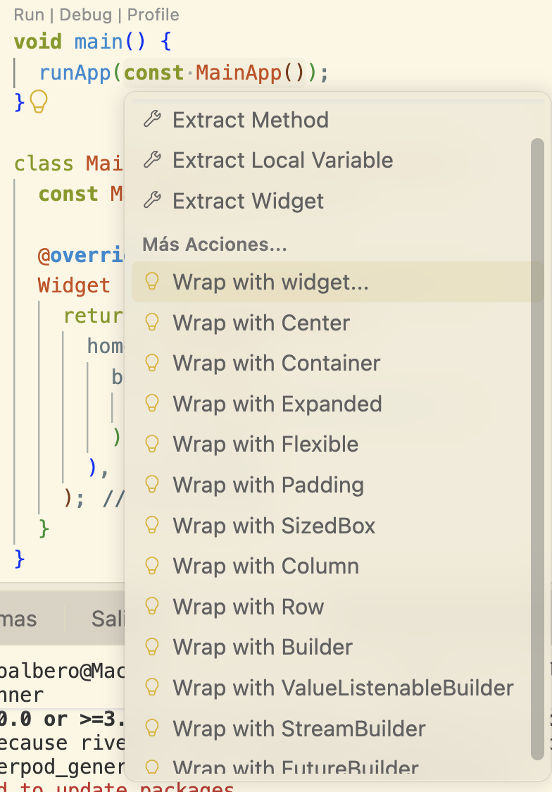

# MANEJO DE ESTADOS

## 1. Mecanismos para el cambio de estado en Flutter

En Flutter hay varias formas de cambiar el estado de una aplicación. Hasta ahora hemos usado `setState` y `StateFulWidget` para conseguirlo, pero tenemos las siguientes:

- `setState`, para estados locales que permanecen en el widget
- `ValueNotifier` y `ChangeNotifier`, para encapsular cambios simples y notificar a la interfaz.
- `Provider`, que permite compartir información y notificadores a través del árbol de widgets.
- `BLoC` o `Cubit`, que comparten el estado usando eventos y streams.
- `Riverpod`, que evita por completo BuildContext.

## 2. ValueNotifier

ValueNotifier nos permite fácilmente compartir un valor entre varios widgets, sin necesidad de transferirlos. Funciona como una especie de variable global que notifica a todo aquel que lo escuche. Necesitamos por un lado una variable `ValueNotifier`, donde se almacena el valor que queremos compartir, y por otro lado un widget `ValueListenableBuilder`, que nos permite escuchar a un `Notifier` y reaccionar cuando su valor cambie. En ambos casos, se trata de elementos genéricos, por lo que hay que indicar entre `<>` el tipo de dato al que hacen referencia.

```dart
//Primero creamos el notifier. Puede ser una variable o incluso una clase que encapsule varios métodos. Esta es la forma más sencilla
final contador = ValueNotifier<int>(0);

class ContadorScreen extends StatelessWidget {
  const ContadorScreen({super.key});

  @override
  Widget build(BuildContext context) {
    return Column(
      children: [
        //Este Widget es el que escuchará al Notifier.
        ValueListenableBuilder<int>(
            //indicamos el Notifier al que escucha
          valueListenable: contador,
          //Construimos el widget que queremos que reaccione al cambio de forma normal
          builder: (context, value, child) {
            return Text("Contador: $value");
          },
        ),
        //Los widgets que efectúan el cambio, pero no reaccionan a él, no necesitan estar en el Listenable.
        Row(
          mainAxisAlignment: MainAxisAlignment.center,
          children: [
            ElevatedButton(
              onPressed: () => contador.value++,
              child: Icon(Icons.add),
            ),
            ElevatedButton(
              onPressed: ()=> contador.value--, 
              child: Icon(Icons.remove)
              )
          ],
        ),
      ],
    );
  }
}
```

`ValueNotifier` es simple, pero efectivo. Sin embargo, tiene muchas limitaciones que lo hacen menos conveniente cuando la complejidad del estado a manejar crece. Para ello, existen otras herramientas como Riverpod.

> **ACTIVIDAD:** Crea una aplicación con 2 pantallas. En todas ellas se ve un nombre, pero el nombre solo se edita en la segunda pantalla, con un TextField. Usa ValueNotifier.

## 3. Riverpod

Riverpod es una librería de manejo de estados, en la cual usamos providers para exponer datos, servicios o lógica, y los consumimos de forma reactiva desde la interfaz de usuario.

Para instalar Riverpod necesitamos añadirlo al proyecto:
```shell
flutter pub add fluter_riverpod
```

Además, si queremos trabajar con anotaciones tenemos que añadir las siguientes librerías:

```shell
flutter pub add riverpod_annotation
flutter pub add --dev riverpod_generator build_runner
```

### 3.1 Trabajar con Providers, Notifiers y Consumers

Para poder usar Riverpod en nuestro proyecto, tenemos que envolver la aplicación principal en un `ProviderScope`. Es decir, pasamos de esto:

```dart
import 'package:flutter/material.dart';

void main() {
  runApp(const MyApp());
}
```
a esto:

```dart
import 'package:flutter/material.dart';
import 'package:flutter_riverpod/flutter_riverpod.dart';

void main() {
  runApp(
    const ProviderScope(
      child: MyApp(),
    ),
  );
}
```

Podemos hacerlo fácilmente usando la herramienta de refactorización y eligiendo `wrap with widget...`. Luego sustituimos widget por `ProviderScope`.



Para poder trabajar dentro, usaremos `Provider` que serán consumidos por `ConsumerWidget`.

Podemos observar el siguiente código para verlo funcionar en su forma más básica, sin cambios:

```dart
void main() {
  runApp(ProviderScope(child: const MainApp()));
}

//creamos un PROVIDER con una referencia para identificarlo. Devuelve un string.
final appNameProvider = Provider<String>((ref){
  return 'Counter';
});

//Creamos un Consumer
class AppTitle extends ConsumerWidget{
  const AppTitle({super.key});

  @override
  Widget build(BuildContext context, WidgetRef ref) {
    //Con el método watch, teniendo en cuenta la referencia ref, el widget escucha al Provider
    final appName = ref.watch(appNameProvider);

    return Text(appName);
  }
  
}

class MainApp extends StatelessWidget {
  const MainApp({super.key});

  @override
  Widget build(BuildContext context) {
    return const MaterialApp(
      home: Scaffold(
        body: Center(
          //Llamamos al consumer
          child: AppTitle(),
        ),
      ),
    );
  }
}
```

Si queremos que el valor cambie, usamos un Notifier. A continuación, el código explicado:

```dart
//Creamos un Notifier
class CounterNotifier extends Notifier<int> {
  //Valor inicial del estado
  @override
  int build() {
    return 0;
  }

  //Modificadores del estado
  void increment() => state++;
  void decrement() => state--;
  void reset() => state = 0;
}

//Creamos un provider con el tipo de Notifier y el dato del estado.
//Los notifier tienen una propiedad new que devuelve un objeto nuevo
//Es equivalente a () => CounterNotifier()
final counterProvider = NotifierProvider<CounterNotifier, int>(
  CounterNotifier.new,
);

//Creamos el consumer
class CounterText extends ConsumerWidget {
  const CounterText({super.key});

  @override
  Widget build(BuildContext context, WidgetRef ref) {
    //COUNT vigila los cambios en el provider
    final count = ref.watch(counterProvider);

    return Column(
      children: [
        Text('Counter: $count'),
        Row(
          mainAxisAlignment: MainAxisAlignment.center,
          children: [
            ElevatedButton(
              //read nos permite leer el notifier de counterProvider y usar sus métodos
              onPressed: () => ref.read(counterProvider.notifier).increment(),
              child: Text("+"),
            ),
            ElevatedButton(
              onPressed: () => ref.read(counterProvider.notifier).decrement(),
              child: Text("-"),
            ),
          ],
        ),
      ],
    );
  }
}

class MainApp extends StatelessWidget {
  const MainApp({super.key});

  @override
  Widget build(BuildContext context) {
    return const MaterialApp(
      home: Scaffold(
        //Añadimos el CONSUMER a nuestra app
        body: Center(child: Column(children: [AppTitle(), CounterText()])),
      ),
    );
  }
}
```

De esta forma, podemos controlar estados más complejos de forma sencilla. La regla es crear un Provider para almacenar los estados, un Notifier con dicho Provider y el tipo de dato que almacena, y un Consumer para mostrar los cambios.

### 3.2 ConsumerStatefulWidget

ConsumerStatefulWidget combina los estados de Riverpod (que son globales a toda la aplicación) con los estados normales (que son propios del Widget y no se comparten con otros).

```dart
import 'package:flutter/material.dart';
import 'package:flutter_riverpod/flutter_riverpod.dart';

//Definimos un notificador de Strings
class UserNameNotifier extends Notifier<String> {
  @override
  String build() => '';

  void changeName(String name) {
    state = name;
  }
}

//Creamos su provider como antes
final userNameProvider = NotifierProvider<UserNameNotifier, String>(
  UserNameNotifier.new,
);

//Creamos el Consumer, pero esta vez como StatefulWidget

class NameForm extends ConsumerStatefulWidget {
  const NameForm({super.key});
  //En lugar de un State, va a tener un ConsumerState
  @override
  ConsumerState<NameForm> createState() => _NameFormState();
}

// CREAMOS LA CLASE DEL ESTADO
// Esta clase ya incorpora ref como propiedad heredada, así que no la necesitamos en el build.

class _NameFormState extends ConsumerState<NameForm> {
  final _nameController = TextEditingController();

  //dispose sirve para liberar recursos, se ejecuta cuando el widget se elimina
  @override
  void dispose() {
    _nameController.dispose();
    super.dispose();
  }

  @override
  Widget build(BuildContext context) {
    return Column(
      children: [
        TextField(controller: _nameController,),
        FilledButton(
          onPressed: () {
            // Podemos usar la propiedad ref porque está heredada
            //En este caso, leemos el providery luego cambiamos el nombre
            ref
                .read(userNameProvider.notifier)
                .changeName(_nameController.text.trim());
          },
          child: const Text('Save'),
        ),
      ],
    );
  }
}
```

Luego simplemente añadimos el widget `NameForm` a nuestra aplicación y ya lo podemos usar.

> **ACTIVIDAD:** Crea una aplicación con tres pantallas, en la segunda puedes introducir un texto con un text field y en la tercera tienes un contador. En la primera, debe aparecer tanto el resultado del conteo como el texto introducido. Usa Riverpod y los dos tipos de consumer que hemos visto.

### 3.3 Providers y datos asíncronos

Provider también puede usarse de forma asíncrona como alternativa a `FutureBuilder`. Usaremos `FutureBuilder` cuando los datos asíncronos afecten solamente al widget en sí mismo, y `AsyncNotifier` cuando los datos sean compartidos entre varios widgets de la aplicación. Nos puede servir para gestionar cosas tan diversas como:

- Obtener una lista de usuarios o datos desde una API.
- Cargar productos de una base de datos.
- Gestionar un login.
- Crear, editar o eliminar elementos.
- Recargar datos después de realizar una operación.

El uso es muy sencillo y muy similar a lo que hemos visto hasta ahora. Lo primero es crear un Notifier, pero asíncrono. Se crea igual que el Notifier normal, pero cambian los tipos de datos. Podemos añadirle, igual que antes, funciones que podríamos querer usar.

```dart
class UserAsyncNotifier extends AsyncNotifier<String>{
  //función de construcción principal, simulamos un retraso con delayed
  @override
  FutureOr<String> build() async {
    await Future.delayed(const Duration(seconds: 4));
    return 'Dato con retraso';
  }

  //Función que añadimos para poder cambiar el estado interno
  void changeName(String n){
    state = AsyncData(n);
  }
  
}
```
> `FutureOr` es un tipo de unión en Dart que representa valores que pueden ser de un tipo específico (T) o una Future de ese mismo tipo. Su propósito principal es permitir que las funciones o callbacks acepten tanto resultados síncronos como asíncronos, evitando la necesidad de envolver valores inmediatos en una Future innecesaria.

Una vez hecho el Notifier, creamos el provider que se de forma análoga al normal, pero usando sus variantes asíncronas:

```dart
final userProviderAsync = AsyncNotifierProvider<UserAsyncNotifier, String>(UserAsyncNotifier.new);
```

Ahora bien, donde sí que cambia el uso es cuando lo queremos consumir. Para poder consumirlo, debemos crear una variable en el método `build` del consumer, como hacíamos de forma normal. Esa variable usará `ref.watch()` sobre el provider asíncrono.

Esa variable tiene un método `when()` que nos permite devolver un widget distinto según los tres estados que puede tener una variable asíncrona: `en espera`, `error` y `finalizado`. Por lo tanto, en lugar de colocar un Widget, colocamos la variable con el método when y dentro funciones anónimas que creen los diferentes widgets según la ocasión:

```dart
userAsyncState.when(
        
  //EL DATO QUE RECIBIMOS FINALMENTE
  data: (asyncDataReceived)=> Text(asyncDataReceived),
  //LO QUE SE VISUALIZA EN CASO DE ERROR 
  error: (error, stackTrace) => Text("Error: $error - $stackTrace"),
  //LO QUE SE VISUALIZA MIENTRAS NO TENEMOS EL DATO
  loading: ()=> Text("En espera")
)
```

Observa el ConsumerWidget entero, para verlo en contexto:

```dart
//Creamos el consumer
class CounterText extends ConsumerWidget {
  const CounterText({super.key});

  @override
  Widget build(BuildContext context, WidgetRef ref) {
    //COUNT vigila los cambios en el provider
    final count = ref.watch(counterProvider);
    final name = ref.watch(userNameProvider);

    //ASYNC PROVIDER => provider asíncrono
    final userAsyncState = ref.watch(userProviderAsync);

    return Column(
      children: [
        Text('Counter: $count con nombre ${(name!="")?name:"desconocido"}'),
        Row(
          mainAxisAlignment: MainAxisAlignment.center,
          children: [
            ElevatedButton(
              //read nos permite leer el notifier de counterProvider y usar sus métodos
              onPressed: () => ref.read(counterProvider.notifier).increment(),
              child: Text("+"),
            ),
            ElevatedButton(
              onPressed: () => ref.read(counterProvider.notifier).decrement(),
              child: Text("-"),
            ),
            
          ],
        ),
        NameForm(),
        Divider(),
        //ASYNC PROVIDER => colocamos la variable con el método when en lugar de un widget normal
        userAsyncState.when(
          //EL DATO QUE RECIBIMOS FINALMENTE
          data: (asyncDataReceived)=> Text(asyncDataReceived),
          //LO QUE SE VISUALIZA EN CASO DE ERROR 
          error: (error, stackTrace) => Text("Error: $error - $stackTrace"),
          //LO QUE SE VISUALIZA MIENTRAS NO TENEMOS EL DATO
          loading: ()=> Text("En espera")
          )
      ],
    );
  }
}
```

> **ACTIVIDAD:** Haz una aplicación con dos ventanas. En una haz que se conecte a la API healthys con la que hemos trabajado y que puedas escribir en un textfield el endpoint al que queremos conectarnos. Si escribes un endpoint incorrecto, que devuelva error. Si escribes un endpoint correcto, que guarde la información. Dicha información se verá en la otra ventana. Usa AsyncNotifier.

----

# PERSISTENCIA

### 4.1 Uso de shared_preferences

### 4.2 Uso de flutter_secure_storage

## 5. Bases de datos locales con Drift

## 6. Drift, repositorios y Riverpod

## 7. Bases de datos en la nube con Supabase